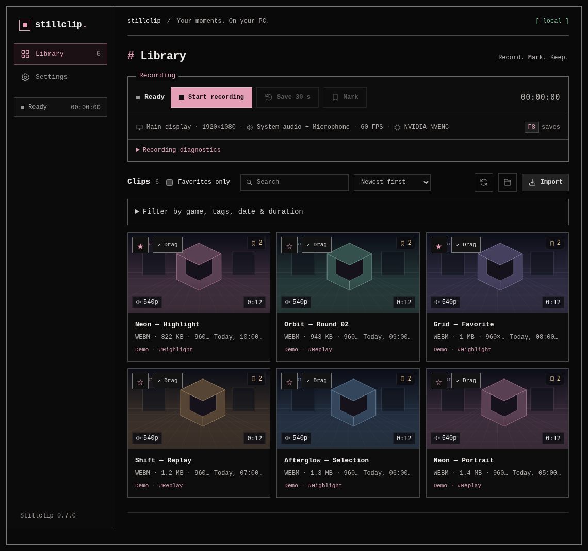

<div align="center">


**The moment passes. Your clip stays.**

Stillclip keeps a rolling buffer of your gameplay. Press a key to save the moment,
then trim it, build a highlight reel, and export it for Discord or in portrait format.

[](https://github.com/elv1n200/stillclip/releases/latest/download/stillclip-windows-x64.zip)

[](https://github.com/elv1n200/stillclip/actions/workflows/verify.yml)  

[Quick start](#quick-start) · [Features](#features) · [User guide (German)](docs/USAGE.md) · [Changelog (German)](CHANGELOG.md)

</div>

---

## Your clips. Your PC.

No account, no required cloud service, no ads. Your videos stay on your PC.
You decide what to keep and what to share.



<sub>The app interface is currently in German. These previews use synthetic demo clips, not actual gameplay recordings.</sub>

## Features

| Record | Edit | Share |
| :--- | :--- | :--- |
| **Instant replay with F8.** Save the last few seconds, even after the moment has passed. | **Trimming & highlights.** Select, reorder, and combine excerpts from multiple clips. | **Discord presets.** Export MP4 files checked against the 20 MB free or 1 GB Nitro limit. |
| **Game profiles.** Set resolution, FPS, clip length, and audio sources for each game. | **Adjustable 9:16 crop.** Choose what stays in frame for Shorts, Reels, and TikTok. | **Export queue.** Track progress, see estimated time remaining, and cancel jobs while you keep editing. |
| **Game audio & microphone.** Choose your sources and check the mix with the audio test. | **Favorites & tags.** Find clips by game, tag, date, or duration. | **Drag files out.** Drop a clip into Discord or File Explorer. |

**Also included:** Window or screen capture, NVENC/AMF/Quick Sync,
markers, a separate microphone track, recording diagnostics, and optional storage limits.
[All features and settings (German) →](docs/USAGE.md)

## From gameplay to a finished clip

**01 · Save** — Start your game, keep recording, and press <kbd>F8</kbd> to save a replay.

**02 · Trim** — Choose the start and end. For portrait video, move the crop frame in the preview.

**03 · Export** — Pick a preset and add it to the queue. Your original file stays intact.


<details>
<summary><strong>See the export queue and highlight editor</strong></summary>


The queue processes up to twelve jobs, one at a time. Source clips stay protected
during exports. Quitting the app cancels unfinished jobs;
minimizing to the system tray lets them continue.

</details>

## Quick start

1. **[Download the Windows ZIP](https://github.com/elv1n200/stillclip/releases/latest/download/stillclip-windows-x64.zip)** and extract it completely into a writable folder.
2. **Install the prerequisites:** [Microsoft Edge WebView2](https://developer.microsoft.com/microsoft-edge/webview2/) and a [Windows build of FFmpeg](https://ffmpeg.org/download.html#build-windows). Keep `ffprobe.exe` next to `ffmpeg.exe` if possible.
3. **Launch `stillclip.exe`.** If FFmpeg is not detected, select it under **Settings (Einstellungen) → FFmpeg**. Choose your display, audio sources, and an optional game profile.
4. **Click Start recording (Aufnahme starten), then press <kbd>F8</kbd>.** Your saved moment appears in the library.

| Requirement | Details |
| :--- | :--- |
| Windows x64 | Windows 11 recommended. Screen capture and system audio are also designed to work on Windows 10. |
| Game audio only | Windows build 20348 or later, such as Windows 11. |
| Game window only | FFmpeg with `gfxcapture` and its `hwnd` option; the app checks for support. |
| Storage | By default, `clips/` and `settings/` live next to the EXE. No installer needed. |

**The ZIP includes Stillclip and its documentation. FFmpeg and WebView2 are separate prerequisites.**
Quit Stillclip before updating, and keep your existing `clips/` and `settings/` folders.

## Good to know

- Recording controls remain available during exports. Actual game performance depends on your PC, encoder, and settings.
- Automated tests cover application logic, the interface, and synthetic media. Real recording, audio devices, and dropping files into Discord also need [hands-on Windows testing (German checklist)](WINDOWS-CHECKS.md).
- Favorites are protected from automatic cleanup. You can still delete them manually; automatic deletion is disabled by default.
- Discord limits may change. The current presets and their source are documented in the [Discord export guide (German)](docs/USAGE.md#für-discord-speichern).

## Build from source

On Windows, with Rust and the Microsoft C++ Build Tools installed:

```powershell
git clone https://github.com/elv1n200/stillclip.git
cd stillclip
cargo build --locked --release
```

The executable is written to `target/release/stillclip.exe`.

[Development & tests (German)](docs/DEVELOPMENT.md) · [Contributing (German)](CONTRIBUTING.md) · [Report an issue (German forms)](https://github.com/elv1n200/stillclip/issues/new/choose) · [Dependencies & credits](CREDITS.md)

---

<div align="center">
<sub>stillclip. · Record. Mark. Keep.</sub>
</div>
