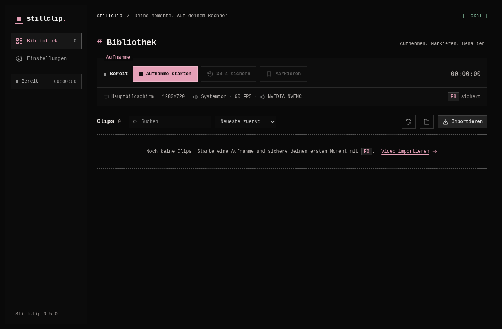
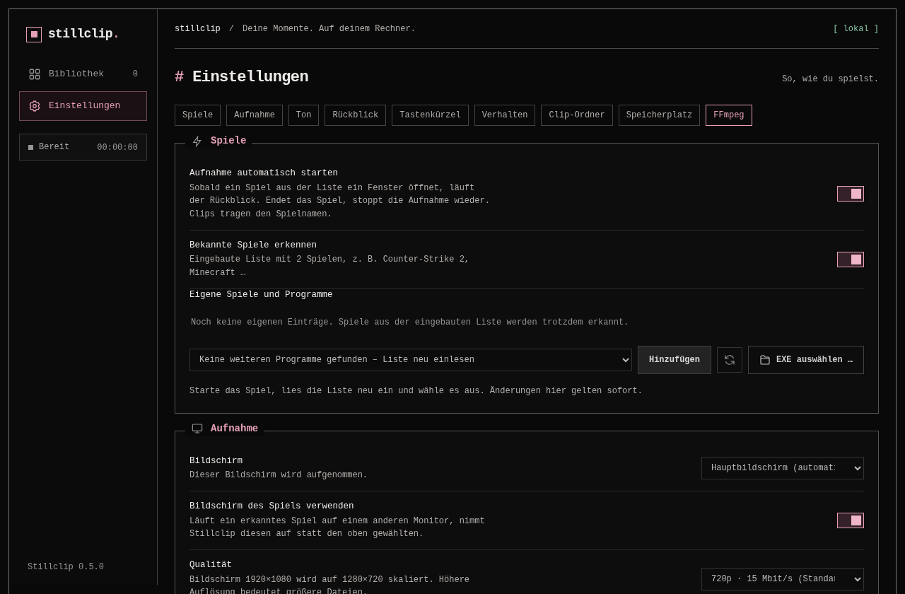

# Stillclip

Eine lokale Windows-App für Spiel- und Bildschirmclips: Stillclip erkennt dein
Spiel, läuft im Hintergrund mit, merkt sich die letzten Sekunden und sichert sie
auf Tastendruck als Clip. Dazu kommen Bibliothek mit Vorschaubildern, Import,
Umbenennen, Zuschneiden und Löschen. Ohne Konto, Cloud-Uploads oder Werbung.

Die Anwendung ist in Rust geschrieben (`tao`, `wry`), die Oberfläche läuft in
der Microsoft Edge WebView2-Laufzeit, Aufnahme und Schnitt übernimmt eine lokal
vorhandene `ffmpeg.exe`.



## Aktueller Stand

Die Oberfläche verwendet einen schwarzen Hintergrund, eckige Rahmen,
Monospace-Schrift und rosa Akzente. Die Einstellungen haben eine direkte
Bereichsnavigation; Bibliothek und Editor verwenden dasselbe Design.

Aufnahme und Clip-Export arbeiten unabhängig: Markieren, Beenden,
Pufferbereinigung und Freiplatzprüfung bleiben während eines Exports aktiv.
Der Export hält eigene Verweise auf seine Segmente und veröffentlicht erst den
fertigen Clip. Start-/Stopp-Wünsche bleiben auch während eines Aufnahmewechsels
erhalten. Eine zweite App-Instanz öffnet das vorhandene Fenster, statt dessen
Puffer wiederherzustellen oder zu löschen.

## Was die App kann

- **Spielerkennung.** Rund 90 bekannte Spiele sind eingebaut; jedes andere
  Programm lässt sich mit einem Klick aus der Liste der laufenden Fenster oder
  über die EXE hinzufügen. Startet ein erkanntes Spiel, beginnt die Aufnahme von
  selbst und endet mit dem Spiel wieder. Clips tragen den Spielnamen, zum
  Beispiel `Counter-Strike 2 2026-11-14 21-04-10.mp4`.
- **Spieleprofile.** Pro Spiel eigene Auflösung, FPS, Rückblicklänge, Ton,
  Mikrofon und Aufnahmequelle einstellen. Das Profil wird beim nächsten Start
  des erkannten Spiels beziehungsweise für das gewählte Zielprogramm angewandt.
  Die allgemeinen Einstellungen werden nicht überschrieben. Profile sind
  während einer laufenden Aufnahme gesperrt.
- **Rückblick ohne Lücke.** Die Aufnahme läuft als Ring aus kurzen
  MPEG-TS-Segmenten. Beim Sichern werden nur die passenden Segmente
  zusammengesetzt und am nächsten Keyframe geschnitten – nichts wird neu
  kodiert, die Aufnahme läuft dabei einfach weiter. Alte Segmente werden laufend
  gelöscht, der Puffer belegt also nur so viel Platz wie die eingestellte
  Rückblicklänge. Wer es exakt braucht, schaltet **Clips exakt zuschneiden** ein;
  dann wird der Clip nach dem Sichern auf die Sekunde genau nachkodiert.
- **Rückmeldung im Spiel.** Ein kurzes Banner oben rechts auf dem
  aufgenommenen Bildschirm und ein Bestätigungston zeigen, dass der Moment
  gesichert ist. Das Banner liegt über Fenster- und randlosen Vollbildspielen
  und ist klickdurchlässig.
- **Der richtige Bildschirm.** Läuft das erkannte Spiel auf einem anderen
  Monitor als dem eingestellten, nimmt Stillclip diesen auf. Das Banner
  erscheint auf demselben Bildschirm.
- **Nur das Spielfenster.** Unter Aufnahme die Fensterquelle und gegebenenfalls
  ein laufendes Zielprogramm wählen. Ein erkanntes Spiel hat Vorrang.
  Windows Graphics Capture nimmt genau dieses Fenster auf; auch ein
  Encoder-Fallback bleibt an das Fenster gebunden. Beim Minimieren oder
  Schließen endet die Aufnahme. Benötigt eine FFmpeg-Version mit dem Filter
  `gfxcapture` und dessen `hwnd`-Option; Stillclip prüft die Unterstützung.
- **Zwei Längen.** Neben der normalen Cliplänge lässt sich eine zweite,
  längere einstellen – mit eigener Taste, zum Beispiel 30 Sekunden für den
  Treffer und fünf Minuten für die ganze Runde.
- **Markieren statt entscheiden.** Eine Taste merkt sich die Stelle, ohne die
  Aufnahme zu stören und ohne eine Datei zu schreiben. Später, in der Pause
  oder nach der Runde, wird daraus mit einem Klick ein Clip – mit frei
  wählbarem Vorlauf und Nachlauf. Stillclip zeigt zu jeder Markierung, ob der
  Moment noch vollständig im Puffer liegt. Im fertigen Clip bleiben die
  Markierungen sichtbar: In der Bibliothek trägt er ein kleines Fähnchen mit
  ihrer Anzahl, im Editor stehen sie auf der Zeitleiste und ein Klick darauf
  springt hin (oder **M** für die nächste, **Umschalt + M** für die vorherige).
  Schneidest du den Clip zu, nimmt der neue Clip die Markierungen mit, die im
  Ausschnitt liegen.
- **Ton.** Systemton (WASAPI-Loopback des Standard-Wiedergabegeräts) und
  wahlweise ein Mikrofon werden in den Clip gemischt, jeweils mit eigener
  Lautstärke von 0 bis 200 Prozent. Wechselt das Wiedergabegerät mitten in der
  Aufnahme, folgt Stillclip automatisch. Das Mikrofon kann zusätzlich als
  eigene zweite Tonspur mitlaufen.
- **Nur Spielton.** Die Tonquelle kann auf das Zielprogramm samt Unterprozessen
  beschränkt werden. Andere Programme wie Discord oder Spotify werden dabei
  nicht über den Systemmix aufgenommen. Das Mikrofon lässt sich weiterhin
  zumischen. Benötigt Windows 11 oder Windows Build 20348+. Falls die
  Prozessaufnahme fehlschlägt, meldet Stillclip den Fehler und startet nicht
  ersatzweise mit dem gesamten Systemton.
- **Speicherplatz.** Stillclip beendet die Aufnahme, bevor das Laufwerk
  volläuft, und kann auf Wunsch die ältesten Clips löschen, sobald der Ordner
  eine eingestellte Größe überschreitet.
- **Hält durch.** Bricht die Aufnahme von selbst ab, etwa weil ein Spiel die
  Bildschirmauflösung umstellt, startet Stillclip sie automatisch neu – bis zu
  dreimal in fünf Minuten.
- **Grafikkarte.** NVENC, AMD AMF oder Intel Quick Sync werden automatisch
  erkannt und genutzt; sonst kodiert die CPU (x264). Die Bildaufnahme läuft
  über Desktop Duplication (`ddagrab`) mit GDI-Fallback.
- **Qualität.** 720p, 1080p, 1440p oder native Auflösung; 24 bis 144 FPS;
  Mauszeiger ein- oder ausblendbar; Auswahl des Bildschirms bei mehreren
  Monitoren.
- **Tastenkürzel.** Frei belegbare globale Kürzel für „Moment sichern“,
  „Längeren Moment sichern“ und „Aufnahme starten/beenden“ (Standard: F8).
- **Hintergrund.** Symbol im Infobereich mit Menü, Schließen minimiert in den
  Infobereich, optional Aufnahme beim Start, minimierter Start und Autostart mit
  Windows (Run-Eintrag des Benutzerkontos).
- **Bibliothek.** Vorschaubilder, Länge, Auflösung, Tonanzeige, Suche und
  Sortierung; Kontextmenü mit Öffnen, Standardplayer, Explorer und Papierkorb.
- **Favoriten.** Der Stern am Clip schützt ihn vor automatischem Aufräumen.
  Ein Filter zeigt nur Favoriten. Der Status bleibt beim Neustart und beim
  Umbenennen erhalten; manuelles Löschen ist weiterhin möglich. Geschützte
  Clips und der neueste Clip können dazu führen, dass das Ordnerlimit nicht
  erreicht wird. Die Prüfung des freien Laufwerksplatzes bleibt aktiv.
- **Editor.** Zeitleiste mit ziehbaren Start-/Endmarken, markierten Momenten,
  Abspielposition, Bildschritte, Schleife der Auswahl, Tastatur (Leertaste,
  I/O, Pfeiltasten, L, M, Entf). Export präzise (neu kodiert) oder schnell
  (ohne Neukodierung).
- **Highlights.** Im Editor Ausschnitte sammeln, weitere Clips öffnen und die
  Liste mit den Pfeilen sortieren. Bis zu 20 Ausschnitte und 30 Minuten werden
  zu einem neuen Video mit 1080p/60 FPS und einer Stereospur verbunden. Andere
  Seitenverhältnisse erhalten Balken, fehlender Ton wird durch Stille ergänzt.
  Markierungen wandern mit. Die Liste ist ein Entwurf bis zum Schließen der
  App. Auch Discord-Export ist möglich; dabei kann die Auflösung sinken.
- **Aufnahmediagnose.** Unter der Aufnahmekarte stehen gemessene Encoder-FPS,
  verworfene/duplizierte Bilder, Zeitrückstand, Puffer und freier Speicher.
  Fehlende Messwerte erscheinen als unbekannt. Die FPS sind keine Spiel-FPS;
  die Anzeige weist auf ausbleibende oder deutlich verspätete Bilder hin.
- **Discord-Export.** Im Editor unter **Export** zwischen **Discord ohne Nitro
  · 20 MB** und **Discord Nitro · 1 GB** wählen. Stillclip passt Bitrate,
  Auflösung und Bildrate an die Länge des ausgewählten Bereichs an (bis
  1080p/60 FPS, ohne Hochskalieren). Eine neue MP4 mit H.264 und AAC landet
  in der Bibliothek; Original und Markierungen bleiben erhalten. Hochgeladen
  wird nichts automatisch.
- **Ganze Sitzung behalten.** Optional wird beim Beenden zusätzlich die
  komplette Aufnahme als Video gespeichert. Nach einem Absturz werden
  übrig gebliebene Segmente einer solchen Sitzung beim nächsten Start
  wiederhergestellt.

## Starten und verwenden

1. Das ZIP aus dem Artefakt **stillclip-windows-x64** eines erfolgreichen
   GitHub-Actions-Laufs entpacken und `stillclip.exe` starten. Bei einem eigenen
   Build liegt sie unter `target/release/stillclip.exe`. Die Microsoft Edge WebView2-Laufzeit
   muss installiert sein (bei Windows 11 immer der Fall).
2. Stillclip sucht eine vorhandene `ffmpeg.exe` (unter anderem `tools/ffmpeg.exe`
   neben der Anwendung, `PATH`, Streamlabs, WinGet). Alternativ unter
   **Einstellungen → Videoverarbeitung → FFmpeg auswählen** die Datei wählen.
   Liegt `ffprobe.exe` daneben, werden Schnitte beim Sichern exakt am Keyframe
   gesetzt; ohne ffprobe wird geschätzt.
3. **Spiel starten.** Erkennt Stillclip es, läuft die Aufnahme sofort. Sonst
   **Aufnahme starten** drücken oder das Spiel unter **Einstellungen → Spiele**
   hinzufügen.
4. Mit **F8** (oder dem eigenen Kürzel) beziehungsweise **Letzte … Sek. sichern**
   landet der Moment als Clip in der Bibliothek; Banner und Ton bestätigen das.
   Wer im Spiel nicht entscheiden will, drückt die Markieren-Taste und sichert
   den Clip später im Fenster unter **Markieren**.
5. **Aufnahme beenden** stoppt den Rückblick. Nur mit der Option „Ganze Sitzung
   behalten“ entsteht dabei zusätzlich ein Video `Aufnahme ….mp4`.
6. Einen Clip anklicken, um ihn abzuspielen, zuzuschneiden, umzubenennen oder
   in den Papierkorb zu verschieben.

Clips liegen standardmäßig im Ordner `clips` neben der EXE, Einstellungen,
Vorschaubilder und der Medienindex unter `settings`. Während einer Aufnahme
liegt der Segmentpuffer im versteckten Unterordner `clips/.stillclip-puffer`
und wird danach entfernt.

### Für Discord speichern

Clip öffnen, den gewünschten Bereich wählen und unter **Export** das passende
Discord-Profil auswählen. **Für Discord speichern** erstellt eine eigene Datei
mit dem Zusatz `- Discord` beziehungsweise `- Discord Nitro`. Diese lässt sich
anschließend aus dem Clip-Ordner in Discord ziehen.

Die Grenzen von 20 MB ohne Nitro und 1 GB mit Nitro entsprechen der
[Discord-Hilfe zu Dateianhängen](https://support.discord.com/hc/de/articles/25444343291031-Dateianh%C3%A4nge-FAQ)
(geprüft am 16. November 2026). Nitro Basic ist ein anderer Tarif und verwendet
nicht das 1-GB-Profil.

Für die Dateigröße kodiert Stillclip in zwei Durchläufen mit x264 auf der CPU,
reserviert Platz für Ton und MP4-Daten und prüft die fertige Datei. Nur ein
vollständiger Export unter dem gewählten Limit wird gespeichert. Bei Bedarf
folgt ein weiterer Versuch mit niedrigerer Bitrate. Ist der Ausschnitt zu lang,
fordert Stillclip einen kürzeren Bereich oder ein größeres Profil an; das Video
wird nie am Dateilimit abgeschnitten. Kurze Clips müssen das Limit nicht
ausschöpfen. Die Aufnahme kann währenddessen weiterlaufen, die zusätzliche
CPU-Last kann sich jedoch auf die Spielleistung auswirken.

Die erste Tonspur enthält bei Stillclip-Aufnahmen bereits Spiel und Mikrofon.
Der Discord-Export übernimmt diese als eine Stereospur; eine zusätzliche
Mikrofonspur wird nicht doppelt eingemischt. Bei importierten Videos wird
ebenfalls die erste Tonspur verwendet.

## Einstellungen



| Bereich | Optionen |
| --- | --- |
| Spiele | Automatisch aufnehmen, eingebaute Spieleliste, eigene Spiele und Programme |
| Aufnahme | Bildschirm, Bildschirm des Spiels verwenden, Qualität (720p/1080p/1440p/nativ), Bildrate, Encoder (automatisch/NVENC/AMF/QSV/CPU), Mauszeiger |
| Ton | Systemton, Lautstärke Systemton, Mikrofon, Mikrofongerät, Lautstärke Mikrofon, Mikrofon als eigene Spur |
| Rückblick | 15, 30, 60, 120, 180, 300 Sekunden oder eigene Länge (15–1200 s), Vorlauf und Nachlauf markierter Momente, zweite Länge, exakte Cliplänge, ganze Sitzung behalten |
| Tastenkürzel | Moment sichern, längeren Moment sichern, Moment markieren, Aufnahme starten/beenden (mit Strg/Alt/Umschalt/Win) |
| Speicherplatz | Aufnahme bei wenig freiem Platz beenden, Ordnergröße begrenzen |
| Verhalten | Banner im Spiel, Ton beim Sichern, in den Infobereich schließen, Aufnahme beim Start, minimiert starten, Autostart |
| Speicherort | Clip-Ordner wählen und öffnen |

Bild, Ton, Rückblicklängen, Markierungsfenster, präziser Export und
Mindestfreiplatz sind während einer Aufnahme gesperrt, damit die angezeigten
Werte immer zur laufenden Sitzung passen. Zum Ändern zuerst die Aufnahme
beenden. Spiele, Tastenkürzel, Ordnerlimit und Verhalten bleiben anpassbar.

## Grenzen dieser Version

- Ohne „Clips exakt zuschneiden“ sitzt der Schnitt auf dem Keyframe vor der
  gewünschten Länge: Ein Clip ist dann bis zu 0,4 Sekunden länger als
  eingestellt, nie kürzer.
- Die Spielerkennung sieht sichtbare Fenster, nicht den Spielzustand. Ein Spiel
  im Launcher-Fenster oder ein Programm, das sein Fenster erst spät öffnet,
  wird entsprechend später erkannt.
- Das Mischen von Systemton und Mikrofon erfolgt in eine gemeinsame Tonspur;
  die optionale zweite Spur enthält nur das Mikrofon.
- Die Bildschirmquelle nimmt den ganzen gewählten Monitor auf. Der automatische
  Monitorwechsel erfolgt nur beim Start. Die Fensterquelle benötigt passende
  Windows-/FFmpeg-Unterstützung; minimierte Fenster und exklusives Vollbild
  können keine verwendbaren Bilder liefern. Es gibt keine Eingriffe in das
  Spiel oder einen Grafik-Hook.
- Markierungen im fertigen Clip merkt sich Stillclip im Medienindex neben der
  Clipdatei, nicht in der Datei selbst. Beim Umbenennen und beim Zuschneiden
  wandern sie mit; wer den Clip außerhalb von Stillclip verschiebt oder
  schneidet, verliert sie.
- Markierungen gehören zu einer Aufnahme: Endet sie, verschwindet der Puffer
  und mit ihm die noch nicht gesicherten Markierungen. Eine Markierung lässt
  sich außerdem nur sichern, solange ihr Fenster im Rückblick liegt – die
  Liste zeigt, wie viele Sekunden noch übrig sind.
- Der automatische Neustart nach einem Abbruch holt den Puffer nicht zurück:
  Die Sekunden zwischen Abbruch und Neustart fehlen. Mit „Ganze Sitzung
  behalten“ wird gar nicht neu gestartet, damit das Material für die
  Wiederherstellung liegen bleibt.
- „Älteste Clips löschen“ löscht endgültig, nicht in den Papierkorb – sonst
  wäre der Platz nicht frei. Die Option ist deshalb von Haus aus aus.
- Das Banner wird über ein eigenes Fenster gezeichnet. Spiele im exklusiven
  Vollbildmodus zeigen es nicht; randloses Vollbild und Fenstermodus schon.
- Die Videovorschau hängt von den Codecs der WebView2-Laufzeit ab. MP4 mit
  H.264 funktioniert am zuverlässigsten; manche importierten Formate lassen
  sich nur über den Standardplayer öffnen.

Die aus dem Original gelesenen Regeln, Funktionsadressen und verbleibenden
Abweichungen stehen in [MECHANICS.md](MECHANICS.md).

## Entwickeln

Windows, Rust/Cargo und die Microsoft C++ Build Tools werden zum Bauen benötigt.
Im Repository-Hauptordner ausführen:

```powershell
cargo build --locked --release
cargo test --locked
```

Weitere Prüfungen:

```powershell
# Synthetische FFmpeg-Tests: Schnitt, Vorschaubild, Segment-Export (kein Bildschirm)
cargo test --locked synthetic_ -- --ignored

# Echte Aufnahme des Hauptbildschirms mit Systemton für etwa zehn Sekunden
cargo test --locked real_capture -- --ignored --nocapture

# Banner einmal anzeigen und als Bild festhalten
$env:STILLCLIP_OVERLAY_SHOT="shots/overlay.png"; cargo test --locked overlay_smoke -- --ignored

# Gerenderte Oberfläche als PNG, ohne Aufnahme
target/release/stillclip.exe --screenshot shots/library.png
target/release/stillclip.exe --screenshot shots/settings.png --page settings
target/release/stillclip.exe --screenshot shots/editor.png --page editor

# Eine bestimmte Stelle der Einstellungen (Element-ID nach dem #)
target/release/stillclip.exe --screenshot shots/ton.png --page "settings#system-volume-row"
```

Optional setzen `STILLCLIP_DATA_DIR` den Einstellungsordner und
`STILLCLIP_FFMPEG` den Pfad zu FFmpeg. `--minimized` startet nur mit dem
Symbol im Infobereich.

### Aufbau

| Datei | Inhalt |
| --- | --- |
| `src/main.rs` | Fenster, WebView, Ereignisschleife, IPC-Aktionen, Hintergrundjobs |
| `src/lifecycle.rs` | Getestete Start-/Stopp-Anforderungen während Aufnahmewechseln |
| `src/export.rs` | Unabhängige Exporte mit gesicherten Segmenten und geschützter Veröffentlichung |
| `src/discord.rs` | Discord-Dateilimits, Bitratenplanung, zweistufiger MP4-Export und Größenprüfung |
| `src/highlights.rs` | Mehrere Ausschnitte vereinheitlichen, verbinden und als Highlight exportieren |
| `src/diagnostics.rs` | Begrenztes Lesen und Auswerten vollständiger FFmpeg-Fortschrittsmeldungen |
| `src/games.rs` | Spieleliste, Fenster-/Prozess-Erkennung, Watcher-Thread |
| `src/capture.rs` | Bildschirme (DXGI), Encoder-Erkennung, FFmpeg-Kommandozeile |
| `src/audio.rs` | WASAPI-Aufnahme (Loopback/Mikrofon) in Named Pipes, Gerätewechsel |
| `src/recorder.rs` | Segment-Ring, Rückblick-Export, Sitzungsexport, Schnitt, Vorschaubilder |
| `src/overlay.rs` | Banner-Fenster im Spiel und Bestätigungston |
| `src/library.rs` | Clip-Ordner, Import, Umbenennen, Medienindex |
| `src/settings.rs` | Einstellungen, Tastenkürzel, Qualitätsstufen |
| `src/platform.rs` | Dialoge, Explorer, Papierkorb, Autostart, Hotkeys, Infobereich |
| `src/encoding.rs`, `src/mechanics.rs` | Aus dem Original übernommene Formeln und Grenzen |
| `ui/` | Oberfläche (`index.html`, `app.css`, `app.js`), wird in die EXE eingebettet |

### Automatische Prüfungen und Downloads

`.github/workflows/verify.yml` baut auf Windows, führt Unit-/Regressionstests
und ausschließlich synthetische FFmpeg-Tests aus und stellt ein portables ZIP
als Actions-Artefakt bereit. FFmpeg und WebView2 werden nicht mitgeliefert.
Echte Bildschirm-/Mikrofonprüfungen bleiben ausdrücklich manuelle Tests.

Die Oberfläche wird separat mit simulierten Zustandsdaten geprüft:

```sh
npm ci
npx playwright install chromium
npm test
```

Optional verwendet `CHROME_BIN` ein vorhandenes Chromium. Mit
`STILLCLIP_SHOTS_DIR` werden Vorschauen bei 1280 und 720 Pixel Breite gespeichert.
Die Screenshots zeigen Browser-Vorschauen mit Testdaten.
Die Browserprüfung ersetzt keinen Windows-Test von WASAPI, Grafikkartentreibern
oder exklusiven Vollbildspielen.

Die manuellen Prüfungen für Fensteraufnahme, Spielton und Spieleprofile stehen
in [WINDOWS-CHECKS.md](WINDOWS-CHECKS.md). Für FFmpeg sind aktuelle Windows-Builds
über die [offizielle Downloadseite](https://ffmpeg.org/download.html) verfügbar;
die Liste in **Videoverarbeitung** und die Meldung unter **Aufnahmequelle**
zeigen, welche Funktionen die ausgewählte Datei unterstützt.
