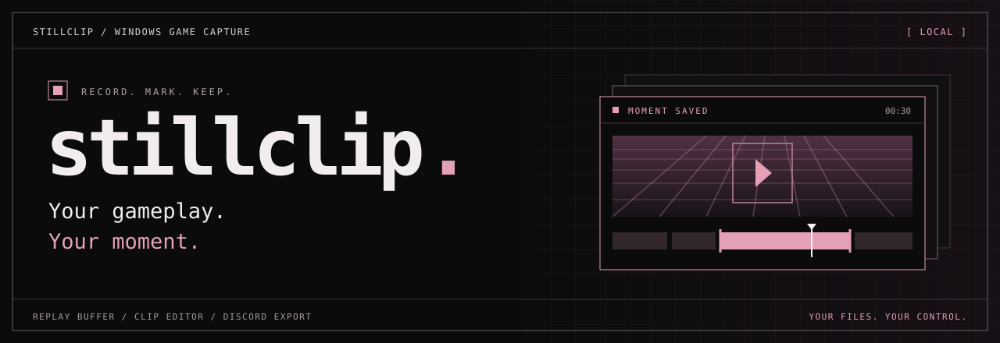
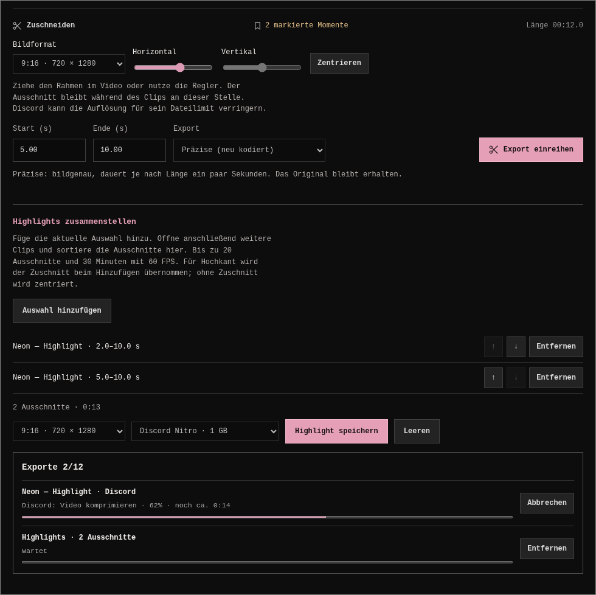

<div align="center">



**Der Moment ist vorbei. Dein Clip bleibt.**

Stillclip hält dein Gameplay im Rückblick bereit. Ein Tastendruck sichert den Moment —
danach schneidest du ihn zu, sammelst Highlights und exportierst ihn für Discord oder im Hochformat.

[](https://github.com/elv1n200/stillclip/releases/latest/download/stillclip-windows-x64.zip)

[](https://github.com/elv1n200/stillclip/actions/workflows/verify.yml)  

[Schnellstart](#schnellstart) · [Funktionen](#was-stillclip-kann) · [Anleitung](docs/USAGE.md) · [Versionshinweise](CHANGELOG.md)

</div>

---

## Deine Clips. Dein Rechner.

Kein Konto, kein Cloud-Zwang, keine Werbung. Videos bleiben auf deinem Rechner.
Du entscheidest, was du behältst und was du teilst.


<sub>Aktuelle Oberfläche mit synthetischen Demo-Clips. Die Vorschauen zeigen keine echten Spielaufnahmen.</sub>

## Was Stillclip kann

| Festhalten | Bearbeiten | Teilen |
| :--- | :--- | :--- |
| **Rückblick mit F8.** Sichere die letzten Sekunden, auch wenn der Moment schon vorbei ist. | **Schnitt & Highlights.** Wähle Ausschnitte, sortiere sie und verbinde mehrere Clips. | **Discord-Profile.** Geprüfte MP4-Dateien für 20 MB ohne Nitro oder 1 GB mit Nitro. |
| **Spieleprofile.** Eigene Auflösung, FPS, Cliplänge und Tonquelle für jedes Spiel. | **Verschiebbarer 9:16-Zuschnitt.** Bestimme den Bildausschnitt für Shorts, Reels und TikTok. | **Exportliste.** Fortschritt, geschätzte Restzeit und Abbrechen, während du weiter bearbeitest. |
| **Spielton & Mikrofon.** Wähle deine Quellen und prüfe den Mix mit dem Audio-Test. | **Favoriten & Tags.** Finde Clips nach Spiel, Tag, Datum oder Länge. | **Dateien direkt ziehen.** Übergib einen Clip an Discord oder den Explorer. |

**Außerdem:** Fenster- oder Bildschirmaufnahme, NVENC/AMF/Quick Sync,
Markierungen, getrennte Mikrofonspur, Aufnahmediagnose und optionale Speichergrenzen.
[Alle Funktionen und Einstellungen →](docs/USAGE.md)

## Vom Moment zum fertigen Clip

**01 · Sichern** — Spiel starten, Aufnahme laufen lassen, mit <kbd>F8</kbd> den Rückblick speichern.

**02 · Zuschneiden** — Start und Ende wählen. Für Hochkant den Rahmen im Vorschaubild verschieben.

**03 · Exportieren** — Profil wählen und einreihen. Die Originaldatei bleibt erhalten.


<details>
<summary><strong>Exportliste und Highlight-Editor ansehen</strong></summary>



Die Liste verarbeitet bis zu zwölf Aufträge nacheinander. Quellclips bleiben während
laufender Exporte geschützt. Beim Beenden werden offene Aufträge abgebrochen;
beim Minimieren in den Infobereich laufen sie weiter.

</details>

## Schnellstart

1. **[Windows-ZIP herunterladen](https://github.com/elv1n200/stillclip/releases/latest/download/stillclip-windows-x64.zip)** und vollständig in einen beschreibbaren Ordner entpacken.
2. **Voraussetzungen bereitstellen:** [Microsoft Edge WebView2](https://developer.microsoft.com/microsoft-edge/webview2/) und einen [FFmpeg-Build für Windows](https://ffmpeg.org/download.html#build-windows). `ffprobe.exe` am besten neben `ffmpeg.exe` ablegen.
3. **`stillclip.exe` starten.** Falls FFmpeg nicht erkannt wird, unter **Einstellungen → FFmpeg** auswählen. Bildschirm, Ton und optional ein Spielprofil einstellen.
4. **Aufnahme starten und <kbd>F8</kbd> drücken.** Der gesicherte Moment erscheint in deiner Bibliothek.

| Voraussetzung | Hinweis |
| :--- | :--- |
| Windows x64 | Windows 11 empfohlen. Bildschirmaufnahme und Systemton sind auch unter Windows 10 vorgesehen. |
| Nur Spielton | Windows Build 20348 oder neuer, zum Beispiel Windows 11. |
| Nur Spielfenster | FFmpeg mit `gfxcapture` und der Option `hwnd`; die App prüft die Unterstützung. |
| Speicherort | Standardmäßig `clips/` und `settings/` neben der EXE, kein Installationsprogramm nötig. |

**Das ZIP enthält Stillclip und die Dokumentation. FFmpeg und WebView2 werden separat bereitgestellt.**
Für ein Update den bisherigen Clip- und Einstellungsordner behalten und die App vorher beenden.

## Gut zu wissen

- Die Aufnahme bleibt beim Export bedienbar. Die tatsächliche Spielleistung hängt von PC, Encoder und Einstellungen ab.
- Automatische Tests prüfen Logik, Oberfläche und synthetische Medien. Reale Aufnahme, Audiogeräte und Discord-Drops benötigen zusätzlich einen [Praxistest unter Windows](WINDOWS-CHECKS.md).
- Favoriten sind vor automatischem Aufräumen geschützt. Manuelles Löschen bleibt möglich; die automatische Löschfunktion ist standardmäßig ausgeschaltet.
- Discord-Limits können sich ändern. Die aktuellen Profile und ihre Grundlage stehen in der [Export-Anleitung](docs/USAGE.md#für-discord-speichern).

## Selbst bauen

Unter Windows mit Rust und den Microsoft C++ Build Tools:

```powershell
git clone https://github.com/elv1n200/stillclip.git
cd stillclip
cargo build --locked --release
```

Die EXE liegt anschließend unter `target/release/stillclip.exe`.

[Entwicklung & Tests](docs/DEVELOPMENT.md) · [Beitragen](CONTRIBUTING.md) · [Fehler melden](https://github.com/elv1n200/stillclip/issues/new/choose) · [Abhängigkeiten & Credits](CREDITS.md)

---

<div align="center">
<sub>stillclip. · Aufnehmen. Markieren. Behalten.</sub>
</div>
