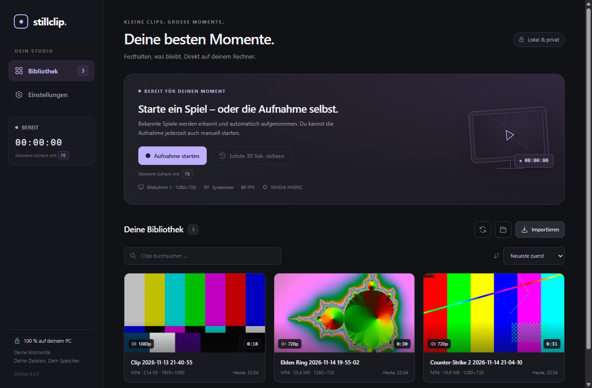
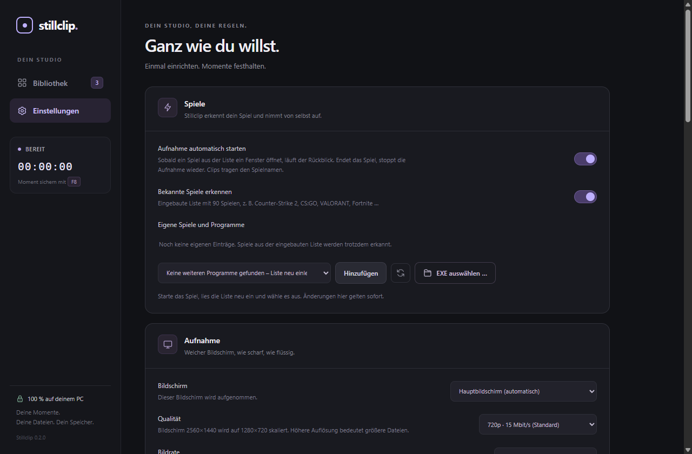

# Stillclip

Eine lokale Windows-App für Spiel- und Bildschirmclips: Stillclip erkennt dein
Spiel, läuft im Hintergrund mit, merkt sich die letzten Sekunden und sichert sie
auf Tastendruck als Clip. Dazu kommen Bibliothek mit Vorschaubildern, Import,
Umbenennen, Zuschneiden und Löschen. Ohne Konto, Cloud-Uploads oder Werbung.

Die Anwendung ist in Rust geschrieben (`tao`, `wry`), die Oberfläche läuft in
der Microsoft Edge WebView2-Laufzeit, Aufnahme und Schnitt übernimmt eine lokal
vorhandene `ffmpeg.exe`.



## Was die App kann

- **Spielerkennung.** Rund 90 bekannte Spiele sind eingebaut; jedes andere
  Programm lässt sich mit einem Klick aus der Liste der laufenden Fenster oder
  über die EXE hinzufügen. Startet ein erkanntes Spiel, beginnt die Aufnahme von
  selbst und endet mit dem Spiel wieder. Clips tragen den Spielnamen, zum
  Beispiel `Counter-Strike 2 2026-11-14 21-04-10.mp4`.
- **Rückblick ohne Lücke.** Die Aufnahme läuft als Ring aus kurzen
  MPEG-TS-Segmenten. Beim Sichern werden nur die passenden Segmente
  zusammengesetzt und am nächsten Keyframe geschnitten – nichts wird neu
  kodiert, die Aufnahme läuft dabei einfach weiter. Alte Segmente werden laufend
  gelöscht, der Puffer belegt also nur so viel Platz wie die eingestellte
  Rückblicklänge. Wer es exakt braucht, schaltet **Clips exakt zuschneiden** ein;
  dann wird der Clip nach dem Sichern auf die Sekunde genau nachkodiert.
- **Rückmeldung im Spiel.** Ein kurzes Banner oben rechts auf dem
  aufgenommenen Bildschirm und ein Bestätigungston zeigen, dass der Moment
  gesichert ist. Das Banner liegt über Fenster- und randlosen Vollbildspielen
  und ist klickdurchlässig.
- **Ton.** Systemton (WASAPI-Loopback des Standard-Wiedergabegeräts) und
  wahlweise ein Mikrofon werden in den Clip gemischt. Wechselt das
  Wiedergabegerät mitten in der Aufnahme, folgt Stillclip automatisch. Das
  Mikrofon kann zusätzlich als eigene zweite Tonspur mitlaufen.
- **Grafikkarte.** NVENC, AMD AMF oder Intel Quick Sync werden automatisch
  erkannt und genutzt; sonst kodiert die CPU (x264). Die Bildaufnahme läuft
  über Desktop Duplication (`ddagrab`) mit GDI-Fallback.
- **Qualität.** 720p, 1080p, 1440p oder native Auflösung; 24 bis 144 FPS;
  Mauszeiger ein- oder ausblendbar; Auswahl des Bildschirms bei mehreren
  Monitoren.
- **Tastenkürzel.** Frei belegbare globale Kürzel für „Moment sichern“ und
  „Aufnahme starten/beenden“ (Standard: F8).
- **Hintergrund.** Symbol im Infobereich mit Menü, Schließen minimiert in den
  Infobereich, optional Aufnahme beim Start, minimierter Start und Autostart mit
  Windows (Run-Eintrag des Benutzerkontos).
- **Bibliothek.** Vorschaubilder, Länge, Auflösung, Tonanzeige, Suche und
  Sortierung; Kontextmenü mit Öffnen, Standardplayer, Explorer und Papierkorb.
- **Editor.** Zeitleiste mit ziehbaren Start-/Endmarken, Abspielposition,
  Bildschritte, Schleife der Auswahl, Tastatur (Leertaste, I/O, Pfeiltasten,
  L, Entf). Export präzise (neu kodiert) oder schnell (ohne Neukodierung).
- **Ganze Sitzung behalten.** Optional wird beim Beenden zusätzlich die
  komplette Aufnahme als Video gespeichert. Nach einem Absturz werden
  übrig gebliebene Segmente einer solchen Sitzung beim nächsten Start
  wiederhergestellt.

## Starten und verwenden

1. `target/release/stillclip.exe` starten. Die Microsoft Edge WebView2-Laufzeit
   muss installiert sein (bei Windows 11 immer der Fall).
2. Stillclip sucht eine vorhandene `ffmpeg.exe` (unter anderem `tools/ffmpeg.exe`
   neben der Anwendung, `PATH`, Streamlabs, WinGet). Alternativ unter
   **Einstellungen → Videoverarbeitung → FFmpeg auswählen** die Datei wählen.
   Liegt `ffprobe.exe` daneben, werden Schnitte beim Sichern exakt am Keyframe
   gesetzt; ohne ffprobe wird geschätzt.
3. **Spiel starten.** Erkennt Stillclip es, läuft die Aufnahme sofort. Sonst
   **Aufnahme starten** drücken oder das Spiel unter **Einstellungen → Spiele**
   hinzufügen.
4. Mit **F8** (oder dem eigenen Kürzel) beziehungsweise **Letzte … Sek. sichern**
   landet der Moment als Clip in der Bibliothek; Banner und Ton bestätigen das.
5. **Aufnahme beenden** stoppt den Rückblick. Nur mit der Option „Ganze Sitzung
   behalten“ entsteht dabei zusätzlich ein Video `Aufnahme ….mp4`.
6. Einen Clip anklicken, um ihn abzuspielen, zuzuschneiden, umzubenennen oder
   in den Papierkorb zu verschieben.

Clips liegen standardmäßig im Ordner `clips` neben der EXE, Einstellungen,
Vorschaubilder und der Medienindex unter `settings`. Während einer Aufnahme
liegt der Segmentpuffer im versteckten Unterordner `clips/.stillclip-puffer`
und wird danach entfernt.

## Einstellungen



| Bereich | Optionen |
| --- | --- |
| Spiele | Automatisch aufnehmen, eingebaute Spieleliste, eigene Spiele und Programme |
| Aufnahme | Bildschirm, Qualität (720p/1080p/1440p/nativ), Bildrate, Encoder (automatisch/NVENC/AMF/QSV/CPU), Mauszeiger |
| Ton | Systemton, Mikrofon, Mikrofongerät, Mikrofon als eigene Spur |
| Rückblick | 15, 30, 60, 120, 180, 300 Sekunden oder eigene Länge (15–1200 s), exakte Cliplänge, ganze Sitzung behalten |
| Tastenkürzel | Moment sichern, Aufnahme starten/beenden (mit Strg/Alt/Umschalt/Win) |
| Verhalten | Banner im Spiel, Ton beim Sichern, in den Infobereich schließen, Aufnahme beim Start, minimiert starten, Autostart |
| Speicherort | Clip-Ordner wählen und öffnen |

Aufnahme- und Ton-Einstellungen gelten ab der nächsten Aufnahme; Spiele,
Tastenkürzel und Verhalten wirken sofort.

## Grenzen dieser Version

- Ohne „Clips exakt zuschneiden“ sitzt der Schnitt auf dem Keyframe vor der
  gewünschten Länge: Ein Clip ist dann bis zu 0,4 Sekunden länger als
  eingestellt, nie kürzer.
- Die Spielerkennung sieht sichtbare Fenster, nicht den Spielzustand. Ein Spiel
  im Launcher-Fenster oder ein Programm, das sein Fenster erst spät öffnet,
  wird entsprechend später erkannt.
- Das Mischen von Systemton und Mikrofon erfolgt in eine gemeinsame Tonspur;
  die optionale zweite Spur enthält nur das Mikrofon.
- Kein Fenster- oder Spielmodus: Aufgenommen wird immer ein ganzer Bildschirm.
- Das Banner wird über ein eigenes Fenster gezeichnet. Spiele im exklusiven
  Vollbildmodus zeigen es nicht; randloses Vollbild und Fenstermodus schon.
- Die Videovorschau hängt von den Codecs der WebView2-Laufzeit ab. MP4 mit
  H.264 funktioniert am zuverlässigsten; manche importierten Formate lassen
  sich nur über den Standardplayer öffnen.

Die aus dem Original gelesenen Regeln, Funktionsadressen und verbleibenden
Abweichungen stehen in [MECHANICS.md](MECHANICS.md).

## Entwickeln

Windows, Rust/Cargo und die Microsoft C++ Build Tools werden zum Bauen benötigt.
Im Ordner `app` ausführen:

```powershell
cargo build --offline --release
cargo test --offline
```

Weitere Prüfungen:

```powershell
# Synthetische FFmpeg-Tests: Schnitt, Vorschaubild, Segment-Export (kein Bildschirm)
cargo test --offline -- --ignored

# Echte Aufnahme des Hauptbildschirms mit Systemton für etwa zehn Sekunden
cargo test --offline real_capture -- --ignored --nocapture

# Banner einmal anzeigen und als Bild festhalten
$env:STILLCLIP_OVERLAY_SHOT="shots/overlay.png"; cargo test --offline overlay_smoke -- --ignored

# Gerenderte Oberfläche als PNG, ohne Aufnahme
target/release/stillclip.exe --screenshot shots/library.png
target/release/stillclip.exe --screenshot shots/settings.png --page settings
target/release/stillclip.exe --screenshot shots/editor.png --page editor
```

Optional setzen `STILLCLIP_DATA_DIR` den Einstellungsordner und
`STILLCLIP_FFMPEG` den Pfad zu FFmpeg. `--minimized` startet nur mit dem
Symbol im Infobereich.

### Aufbau

| Datei | Inhalt |
| --- | --- |
| `src/main.rs` | Fenster, WebView, Ereignisschleife, IPC-Aktionen, Hintergrundjobs |
| `src/games.rs` | Spieleliste, Fenster-/Prozess-Erkennung, Watcher-Thread |
| `src/capture.rs` | Bildschirme (DXGI), Encoder-Erkennung, FFmpeg-Kommandozeile |
| `src/audio.rs` | WASAPI-Aufnahme (Loopback/Mikrofon) in Named Pipes, Gerätewechsel |
| `src/recorder.rs` | Segment-Ring, Rückblick-Export, Sitzungsexport, Schnitt, Vorschaubilder |
| `src/overlay.rs` | Banner-Fenster im Spiel und Bestätigungston |
| `src/library.rs` | Clip-Ordner, Import, Umbenennen, Medienindex |
| `src/settings.rs` | Einstellungen, Tastenkürzel, Qualitätsstufen |
| `src/platform.rs` | Dialoge, Explorer, Papierkorb, Autostart, Hotkeys, Infobereich |
| `src/encoding.rs`, `src/mechanics.rs` | Aus dem Original übernommene Formeln und Grenzen |
| `ui/` | Oberfläche (`index.html`, `app.css`, `app.js`), wird in die EXE eingebettet |
