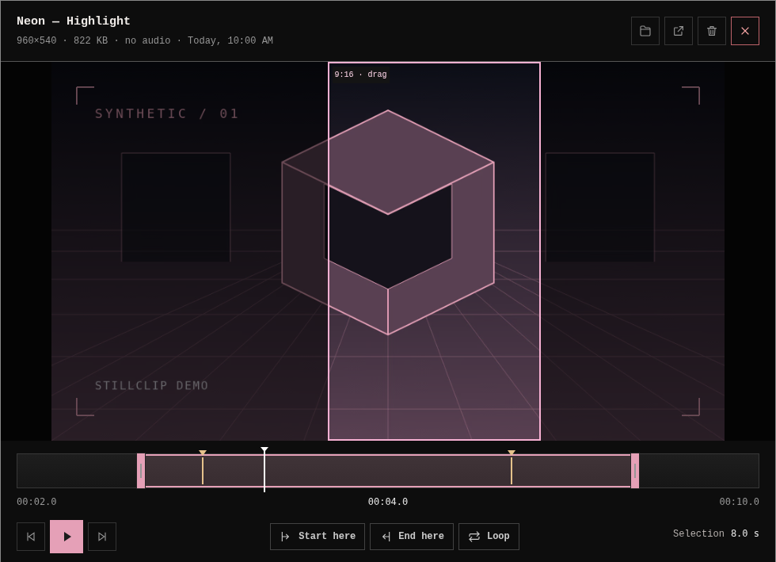

<div align="center">


**The moment passes. Your clip stays.**

Stillclip keeps a rolling buffer of your gameplay. Press a key to save the moment,
then trim it, build a highlight reel, and export it for Discord or in portrait format.

[](https://github.com/elv1n200/stillclip/releases/latest/download/stillclip-setup-online-x64.exe)

**[Online installer](https://github.com/elv1n200/stillclip/releases/latest/download/stillclip-setup-online-x64.exe) · [Offline installer](https://github.com/elv1n200/stillclip/releases/latest/download/stillclip-setup-offline-x64.exe) · [Portable ZIP](https://github.com/elv1n200/stillclip/releases/latest/download/stillclip-windows-x64.zip)**

[](https://github.com/elv1n200/stillclip/actions/workflows/verify.yml)  

[Quick start](#quick-start) · [Features](#features) · [User guide](docs/USAGE.en.md) · [Changelog](CHANGELOG.md)

</div>

---

## Your clips. Your PC.

No account, no required cloud service, no ads. Your videos stay on your PC.
You decide what to keep and what to share.


<sub>Available in English and German. These previews use synthetic demo clips, not actual gameplay recordings.</sub>

## Features

| Record | Edit | Share |
| :--- | :--- | :--- |
| **Instant replay with F8.** Save the last few seconds, even after the moment has passed. | **Trimming & highlights.** Select, reorder, and combine excerpts from multiple clips. | **Discord presets.** Export MP4 files checked against the 20 MB free or 1 GB Nitro limit. |
| **Game profiles.** Set resolution, FPS, clip length, and audio sources for each game. | **Adjustable 9:16 crop.** Choose what stays in frame for Shorts, Reels, and TikTok. | **Export queue.** Track progress, see estimated time remaining, and cancel jobs while you keep editing. |
| **Game audio & microphone.** Choose your sources and check the mix with the audio test. | **Favorites & tags.** Find clips by game, tag, date, or duration. | **Drag files out.** Drop a clip into Discord or File Explorer. |

**Also included:** Window or screen capture, NVENC/AMF/Quick Sync,
markers, isolated game/microphone tracks, a configurable recording HUD,
recording diagnostics, and optional storage limits.
**Desktop workflow:** A first-run assistant with an optional ten-second test recording,
a waveform editor with mix previews, in-app update checks, and a diagnostic report
that you can review before sharing. Experimental local VALORANT killfeed analysis
suggests moments for manual review; the OCR models are included in every download.

[All features and settings →](docs/USAGE.en.md)

## From gameplay to a finished clip

**01 · Save** — Start your game, keep recording, and press <kbd>F8</kbd> to save a replay.

**02 · Trim** — Choose the start and end. For portrait video, move the crop frame in the preview.

**03 · Export** — Pick a preset and add it to the queue. Your original file stays intact.



<details>
<summary><strong>See the export queue and highlight editor</strong></summary>


The queue processes up to twelve jobs, one at a time. Source clips stay protected
during exports. Quitting the app cancels unfinished jobs;
minimizing to the system tray lets them continue.

</details>

## Quick start

1. **Choose an installer:** [Online](https://github.com/elv1n200/stillclip/releases/latest/download/stillclip-setup-online-x64.exe) is a smaller download and fetches components during setup. [Offline](https://github.com/elv1n200/stillclip/releases/latest/download/stillclip-setup-offline-x64.exe) includes everything needed for installation.
2. **Run setup and open Stillclip from the Start menu.** FFmpeg is included; Microsoft WebView2 is installed automatically when needed. No Rust, Python, or separate FFmpeg installation is required.
3. **Follow the setup assistant.** Choose English or Deutsch, your capture source, quality, and audio. Optionally record a ten-second test and review it before finishing. Reopen setup or change the language later in Settings.
4. **Click Start recording, then press <kbd>F8</kbd>.** Your saved replay appears in the library.

| Download | Best for | Internet during installation |
| :--- | :--- | :--- |
| **Online installer** | A small setup download; fetches verified components as needed. | Required |
| **Offline installer** | Installing on a PC without internet, or keeping a complete installation package. | Not required |
| **Portable ZIP** | Keeping Stillclip in your own writable folder. Includes FFmpeg. | WebView2 must already be installed |

| Requirement | Details |
| :--- | :--- |
| Windows x64 | Windows 11 recommended; Windows 10 build 19041 or later. |
| Game audio only | Windows build 20348 or later, such as Windows 11. |
| Game window only | Included FFmpeg supports `gfxcapture` with `hwnd`; the app checks system support. |
| Installed recordings | Your Windows **Videos/Stillclip** folder, or a custom folder selected in Settings. |
| Installed settings | `%LOCALAPPDATA%\Stillclip\settings`. Updates and uninstall keep your data. |
| Portable storage | `clips/` and `settings/` next to `stillclip.exe`, as in previous releases. |

Use **Settings → Desktop & setup → Updates** to check release notes and download a verified update. Installed copies can launch setup after Stillclip closes; portable copies show the verified ZIP for manual replacement. Both installers update the same application; you can switch between them.
[Installation, portable migration, checksums, and uninstall →](docs/INSTALLATION.md)

## Good to know

- Recording controls remain available during exports. Actual game performance depends on your PC, encoder, and settings.
- Highlight suggestions are experimental, currently support ASCII player names, and can miss or misread scenes. No accuracy claim is made for real matches. Review suggestions before keeping them.
- Automated tests cover application logic, the interface, and synthetic media. Real recording, audio devices, and dropping files into Discord also need [hands-on Windows testing (German checklist)](WINDOWS-CHECKS.md).
- Favorites are protected from automatic cleanup. You can still delete them manually; automatic deletion is disabled by default.
- Discord limits may change. The current presets and their source are documented in the [Discord export guide (German)](docs/USAGE.md#für-discord-speichern).

## Build from source

On Windows, with Rust and the Microsoft C++ Build Tools installed:

```powershell
git clone https://github.com/elv1n200/stillclip.git
cd stillclip
cargo build --locked --release
./packaging/fetch-models.ps1 -OutputDir target/release/models
```

The executable is written to `target/release/stillclip.exe`.

[Development & tests (German)](docs/DEVELOPMENT.md) · [Contributing (German)](CONTRIBUTING.md) · [Report an issue (German forms)](https://github.com/elv1n200/stillclip/issues/new/choose) · [Dependencies & credits](CREDITS.md)

---

<div align="center">
<sub>stillclip. · Record. Mark. Keep.</sub>
</div>
